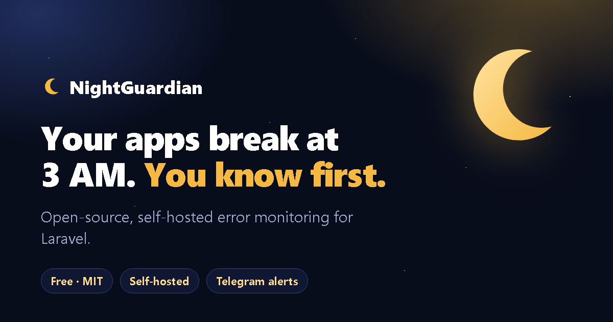

<p align="center">
  <a href="https://nightguardian.com.ar"></a>
</p>

<h1 align="center">🌙 NightGuardian site &amp; live demo</h1>

<p align="center">
  <a href="https://github.com/pablozagni/nightguardian-demo/actions/workflows/ci.yml"></a>
  <a href="LICENSE"></a>
  
  <a href="https://nightguardian.com.ar"></a>
</p>

<p align="center">
  <a href="https://nightguardian.com.ar">Website</a> ·
  <a href="https://nightguardian.com.ar/try">Live demo</a> ·
  <a href="https://github.com/pablozagni/nightguardian">Collector</a> ·
  <a href="https://github.com/pablozagni/nightguardian-laravel">Laravel SDK</a> ·
  <a href="README.es.md">Español</a>
</p>

This repository is the source of **[nightguardian.com.ar](https://nightguardian.com.ar)**, the public site of
[NightGuardian](https://github.com/pablozagni/nightguardian) (open-source, self-hosted error monitoring), and of its
**live demo**: a small Laravel 13 application with one page of buttons. Each button makes the app do one thing that
NightGuardian should report — or deliberately should **not** report — so you can try a collector, see how the SDK behaves
or check that your alerts work.

It installs the real SDK from Packagist (`composer require nightguardian/laravel`), exactly like your own app would.

- **`/`** — the landing page, in English and Spanish (selector in the header; the default follows the browser). Product
  explanation, features, how it works, screenshots, install in 3 steps, SDKs, links and a "support the project" section.
- **`/try`** — the live demo: the buttons below.
- SEO: title, description, Open Graph image, canonical and `hreflang` links, JSON-LD and `/sitemap.xml`.

## What the buttons do

| Button | What it does | What arrives at the collector |
|---|---|---|
| **Throw an exception** | An exception nobody catches → HTTP 500 | A page with a reference code (`NG-XXXX-XXXX`) and a feedback box; an exception issue; the feedback you send, attached to it |
| **Report a handled error** | `NightGuardian::report($e, [...])` with context | An exception marked *handled*, with `order_id`, `gateway`, `attempt` |
| **Write the logs** | `Log::error()` and `Log::warning()` | The error as a log issue (the warning only with `NIGHTGUARDIAN_LOG_LEVEL=warning`) |
| **Call the JSON endpoint** | A failing request that asks for JSON | An exception issue; the body stays Laravel's JSON and only gets the `X-NightGuardian-Reference` header |
| **Make a slow request** | A request of a few seconds (threshold 2 s) | A slow request event |
| **Run a slow query** | `SELECT SLEEP(1.5)` (threshold 1 s) — needs MySQL/MariaDB | A slow query event with the SQL |
| **Queue the job** / **Process the queue now** | A job that always fails, on the database queue | A failed job event |
| **Arm the failing task** / **Run the scheduler now** | A scheduled command (`demo:fail`) that fails once | A failed scheduled task event |
| **Send the burst** | N identical errors (at most 20 on the public site) | One issue whose event count grows by N |
| **Mark a deploy** | `php artisan nightguardian:deploy` | A deploy marker |
| 404 / validation error / 419 | Normal application behaviour | **Nothing.** NightGuardian ignores them on purpose |

After each button the page links to the demo panel. The page also shows the output of `php artisan nightguardian:status`.

## Run it yourself, against any collector

You need PHP 8.3+, Composer, and a NightGuardian collector with a project and a token
(in the collector: *Projects → your project → Tokens → Create token*; the panel shows the two lines you need).

```bash
git clone https://github.com/pablozagni/nightguardian-demo.git
cd nightguardian-demo
composer install
cp .env.example .env
php artisan key:generate
touch database/database.sqlite && php artisan migrate     # SQLite by default
```

Edit `.env`:

```dotenv
NIGHTGUARDIAN_URL=https://nightguardian.example.com     # your collector
NIGHTGUARDIAN_TOKEN=ng_...                              # the project token
NIGHTGUARDIAN_PANEL_URL=https://nightguardian.example.com   # where the "open the panel" links point
```

Run it and open <http://localhost:8000> (the buttons are at <http://localhost:8000/try>):

```bash
php artisan serve
```

Keep `APP_DEBUG=false` (the default in `.env.example`): with `true`, Laravel shows its own debug page and NightGuardian's
friendly page with the reference code does not appear.

Failing jobs and scheduled tasks can be run without a console from the page, but this is how they work for real:

```bash
php artisan queue:work          # processes the failing job queued by the "Queue the job" button
php artisan schedule:work       # runs the failing task armed by the "Arm the failing task" button
```

The slow query button needs MySQL or MariaDB (`DB_CONNECTION=mysql` and a database); with SQLite it explains that it is skipped.

## Configuration

| Variable | Default | What it does |
|---|---|---|
| `NIGHTGUARDIAN_URL`, `NIGHTGUARDIAN_TOKEN` | — | Where the events go (the SDK is inactive without them) |
| `NIGHTGUARDIAN_PANEL_URL` | `https://demo.nightguardian.com.ar` | Panel links shown on the site and after each button |
| `NIGHTGUARDIAN_DEMO_VISITOR_EMAIL` / `_PASSWORD` | `visitor@demo.example.com` / `visitor-demo` | The read-only panel account shown on the landing page |
| `DEMO_TRY_RATE_LIMIT` | `20` | Actions per minute and per IP on `/try` |
| `DEMO_BURST_MAX` | `20` | Largest burst |
| `DEMO_KEY` | empty | If set, `/try` asks for this key first (for a private demo) |
| `NIGHTGUARDIAN_SPONSOR_GITHUB_URL` | empty | "Sponsor on GitHub" button (hidden when empty) |
| `NIGHTGUARDIAN_DONATE_MP_URL` | empty | "Donate with Mercado Pago" button and its QR code (hidden when empty) |
| `NIGHTGUARDIAN_SITE_URL` | `https://nightguardian.com.ar` | Canonical links, Open Graph and sitemap |

Use a throwaway project in your collector: the demo creates real issues and alerts. For a public site, run the collector in
[demo mode](https://github.com/pablozagni/nightguardian/blob/main/docs/demo-mode.md) (read-only visitor, nightly reset,
lower ingest limit).

## Notes

- Events are sent **after** the response, so they appear in the collector a moment after you press a button. If the collector is
  down, the SDK keeps them in `storage/nightguardian/spool` and sends them later; `nightguardian:status` shows it.
- The tests (`vendor/bin/pest`) run with the SDK switched off: they never contact a collector.

## License

MIT, see [LICENSE](LICENSE). Made in Argentina by [z.system](https://www.z-system.com.ar).
